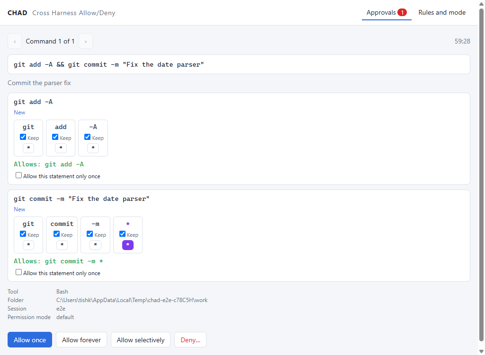
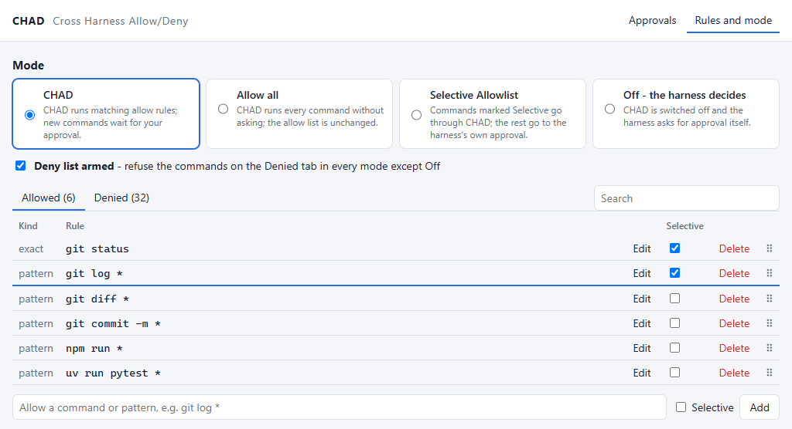

# CHAD - Cross Harness Allow/Deny

A desktop approval layer for the shell commands an AI coding agent runs. Today CHAD works with
[Claude Code](https://code.claude.com/docs) only, but the idea is not tied to it: any agent
harness with a pre-command hook that can refuse a call with a message for the model could use the
same lists and the same window through a small adapter (see
[the possible extensions](#possible-extension-a-policy-set-by-an-administrator), item 5).

In Claude Code, CHAD sits in front of the `Bash` and `PowerShell` tools as a
`PreToolUse` hook: commands you have allowed run without a prompt, commands on the deny list are
refused, and anything new is put in front of you in a tray window, where one click can also turn
it into a reusable rule.



```
Claude Code ──stdin JSON──▶ hook client ──TCP 127.0.0.1 + token──▶ dispatcher ◀──▶ Electron tray UI
            ◀─stdout JSON──             ◀─────── verdict ───────────
```

- **Rules that generalise.** Approving `git commit -m "fix typo"` you can mark the message as `*`
  and store `git commit -m *`: anything after `-m`, no other git verb. New patterns prune the
  narrower rules they make redundant.
- **Chains are judged statement by statement.** `git add . && git commit -m x` runs without
  asking only if every statement is allowed. Anything whose effect cannot be read from the text
  (command substitution, redirection to anything but a plain file in the working folder, `eval`,
  `Invoke-Expression`, ...) is never auto-allowed. A rule covers `> out.log` only by naming it:
  `*` never stands for a redirect. Claude Code's `$(cat <<'EOF' ... EOF)` commit-message idiom is recognised as
  literal text.
- **A deny list above every other rule.** A rule catches any statement that contains all its
  words, in any order: `rm -rf` stops `rm dist -rf` and `bash -c "rm -rf /"` as well.
- **Modes, switchable live.** Ask (CHAD), allow everything, run only the commands marked
  Selective and hand the rest to the harness's own approval (Claude Code's prompt today), or
  switch off - from the window, the CLI or the agent, with nothing restarted.
- **Fails closed, says why.** If CHAD fails (the dispatcher does not start or answer, its code
  does not load), the command does not run and the agent is told that CHAD is broken and why.
  `chad mode off` in your own terminal hands every command back to the harness until it is
  fixed.

CHAD runs commands it approves in its own dispatcher: Bash calls use Bash, and PowerShell calls
use PowerShell. The hook then returns `deny` with the exit code and bounded output, so Claude Code
does not execute the command a second time. Calls handed back by Off mode or an uncovered
Selective-mode command still go through Claude Code's normal permission flow.

The full behaviour is specified in [docs/SPEC.md](docs/SPEC.md).

## Requirements

- Windows 10/11 (the primary platform; the Python side also runs on Linux and macOS, where the
  user environment is a JSON file instead of the registry and autostart is not set up)
- Python 3.12+ and [uv](https://docs.astral.sh/uv/)
- Node.js 22.12+ (for the Electron UI)
- Claude Code 2.x

## Installing from this repository

Everything is installed for the current user only. Nothing is written into any project.
From a clone of this repository:

```powershell
# 1. The Python backend (hook client, dispatcher, CLI) into .venv
uv sync

# 2. The tray UI
cd ui
npm ci            # also downloads the Electron binary
npm run build     # or `npm run package` for a standalone CHAD.exe under ui/release/
cd ..

# 3. Wire it into Claude Code for your user
uv run chad install
```

Then restart Claude Code so it loads the hook.

`chad install` (safe to run again; `--help` lists the options):

| Step | Where |
|---|---|
| Creates the data folder with `config.yaml`, `allow-list.yaml`, `deny-list.yaml` | `%LOCALAPPDATA%\CHAD` |
| Sets `CHAD_HOME` (and `CHAD_DENY=1` with `--deny`) as a **user** environment variable | `HKCU\Environment` |
| Merges the hook into your **user** Claude Code settings, backing up the previous file as `settings.json.chad-backup-<time>` | `~/.claude/settings.json` (or `$CLAUDE_CONFIG_DIR`) |
| Copies the skills into your **user** skills folder | `~/.claude/skills/<name>/` |
| Writes `chad` / `chad.cmd` shims | `~/.local/bin` (`--bin-dir`) |
| Starts the dispatcher at logon (skip with `--no-autostart`) | `HKCU\...\CurrentVersion\Run` |

The hook entry points at this checkout's `.venv` Python, so keep the folder where it is (or run
`chad install` again after moving it). The hook it writes looks like this:

```json
{"hooks": {"PreToolUse": [{"matcher": "Bash|PowerShell", "hooks": [
  {"type": "command", "command": "\"C:/src/CHAD/.venv/Scripts/python.exe\" -m chad.hook", "timeout": 3600}]}]}}
```

### Uninstalling

```powershell
chad uninstall           # removes the hook, skills, shims, autostart and CHAD_HOME
chad uninstall --purge   # ...and deletes the data folder with your rules and audit log
```

Other hooks and settings in `settings.json` are left as they were.

## Environment variables

Mode switches are **user** environment variables, read on every command, so a change applies to
the next command of an already running Claude Code. Use `chad mode ...` / `chad deny ...` or the
window rather than setting them by hand; the mode commands write all three mode variables at
once so a stale one cannot come back.

| Variable | Set by | Effect |
|---|---|---|
| `CHAD_HOME` | `chad install` | Data folder. Default `%LOCALAPPDATA%\CHAD` (`$XDG_STATE_HOME/chad` elsewhere). |
| `CHAD_DISABLED` | `chad mode off` | Off: the hook steps aside and the harness (Claude Code today) asks for approval itself. |
| `CHAD_SELECTIVE_ALLOWLIST` | `chad mode selective` | Selective: commands covered by rules marked Selective go through CHAD; every other command goes to the harness's own approval (Claude Code's prompt). |
| `CHAD_ALLOW_ALL` | `chad mode allow-all` | Allow all: CHAD runs every command without asking. Nothing is written to the allow list. |
| `CHAD_DENY` | `chad deny on`, `chad install --deny` | Arms the deny list, in every mode except Off. |
| `CHAD_UI_DISABLED` | you | The dispatcher runs without the tray UI. |
| `CHAD_ISOLATED` | tests | Switches come from `user-environment.json` in `CHAD_HOME` instead of the registry, and `chad install` refuses the real `~/.claude`. |
| `CHAD_UI_HIDDEN` | tests | The UI never puts its window on screen. |

On values: `1`, `true`, `yes`, `on`, `y` (any case). Anything else, including `0`, is off.
None set means mode CHAD. If several mode variables are set, Off wins, then Selective, then
Allow all.

`config.yaml` in the data folder holds `hookTimeoutSeconds` (3600, must match the hook entry),
`safetyMarginSeconds` (30), `maxCommandSeconds` (1800), `maxOutputBytes` (30000), `launchUi`
and `uiCommand`.

## Skills

The `skills/` folder ships three Claude Code skills that teach the agent how to work with CHAD.
`chad install` copies them into `~/.claude/skills/`, so they are available in every project; to
install them by hand, copy each folder there.

| Skill | What it does |
|---|---|
| `chad` | Explains the modes, the deny list and every `[CHAD]` answer; switches modes with `chad mode ...` when you ask. |
| `chad-allow-deny-list` | Opens the policy window by running the `#chad:allow-deny-list` marker. Works even when CHAD is Off. |
| `chad-add-selective-command` | User-invoked only (`/chad-add-selective-command`). In Selective mode, after you reject Claude Code's prompt for a command, it opens CHAD's editor to add that command as a Selective rule and then runs it. |

The two markers are comments in both shells, so if one ever reaches a real shell it does nothing.

## Using it

**Approval window.** A new command opens the window with the command, Claude's one-line
description and one card per statement. Each word is a tile: keep it, make it `*`, or untick it
to drop it; a live "Allows: ..." line shows the rule you are building and turns red if it would
not even cover its own statement. Then:

- **Allow once** - runs it, remembers nothing.
- **Allow forever** - runs it and stores the rules.
- **Allow selectively** - stores them as Selective rules (used in both CHAD and Selective mode).
- **Deny...** - asks for an optional reason, which the model reads.

Buttons are disabled for 900 ms after a command appears so a stray click cannot answer it.
Commands queue; the window does not switch under your hands. An unanswered command is denied
just before the hook would time out.

**Policy window** (tray menu, `chad open`, or the `chad-allow-deny-list` skill): mode, deny
switch, the Allowed and Denied lists with search, drag to reorder, Selective tick, delete, add.
Edits to the YAML files are picked up live too.



**CLI**

```
chad status                         mode, deny list, dispatcher, pending count
chad mode chad|allow-all|selective|off
chad deny on|off
chad open                           show the policy window
chad start | stop | restart         the dispatcher
chad install | uninstall            see above
```

**Data folder:** `allow-list.yaml`, `deny-list.yaml`, `config.yaml`, `audit.log` (one line per
decision), `dispatcher.log`, `hook.log`, `ui.log`.

`audit.log` holds every command in full, including any secrets typed on the command line, and
grows without limit; delete or trim it as needed. `dispatcher.log` rotates at 1 MB.

## Claude Code's permission settings

How CHAD's answers combine with Claude Code's own settings
([hooks reference](https://code.claude.com/docs/en/hooks)):

- CHAD runs its approved commands itself and returns `deny` with the result. Claude Code's
  `permissions.deny` / `permissions.ask` rules and protected paths (`.git`, `.claude`) do not
  mediate those executions; use CHAD's deny list for commands CHAD must refuse. Calls handed back
  in Off mode or by uncovered Selective mode follow Claude Code's normal permission settings.
- CHAD's **deny** applies in every permission mode, `bypassPermissions` and
  `--dangerously-skip-permissions` included.
- In **Selective** mode, a command without a Selective rule goes through Claude Code's own
  permission handling.
- Hooks fire for tool calls inside subagents too.

The `chad` skill tells the agent that a `[CHAD] COMMAND EXECUTED` denial is intentional, carries
the real result, and must not be repeated.

## Scope

CHAD judges command text. An allowed program can do anything that program can do; CHAD does not
sandbox it.

## Possible extension: a policy set by an administrator

Not implemented. CHAD's design allows it with a modest amount of work: an administrator
installs CHAD as the required hook for every agent harness on a machine, so one allow/deny
policy, set centrally, applies to Claude Code and the other harnesses alike.

**What already works for this.** Claude Code has
[managed settings](https://code.claude.com/docs/en/managed-settings), which users cannot change:

- the file `C:\Program Files\ClaudeCode\managed-settings.json`
  (`/Library/Application Support/ClaudeCode/` on macOS, `/etc/claude-code/` on Linux); the
  `HKLM\SOFTWARE\Policies\ClaudeCode` registry key; a `managed-settings.d/` drop-in folder;
- a hook registered there cannot be switched off from user or project settings;
- `allowManagedHooksOnly: true` blocks user, project and plugin hooks;
- `allowManagedPermissionRulesOnly: true` restricts the permission rules Claude Code uses for
  calls it executes itself; CHAD-run commands are enforced by CHAD's own policy and deny list;
- `permissions.disableBypassPermissionsMode` turns off bypass mode for everyone.

With that alone, an administrator can copy CHAD into a folder users cannot write to
(`C:\Program Files\CHAD`, with its `.venv`) and register `python -m chad.hook` from there in
managed settings. Every Claude Code session on the machine then goes through CHAD.

**What would have to be added:**

1. **A machine-wide policy file.** For example `%ProgramData%\CHAD\managed.yaml` (`/etc/chad/`
   elsewhere), plus a `managed.d/` folder so configuration management (Group Policy, Intune,
   Ansible, ...) can drop in one file per team. It would hold:
   - deny rules that are always armed, in every mode including Off;
   - allow rules users cannot delete;
   - the modes users may choose;

   Users would keep their own lists on top of it, and the window would show the
   administrator's rows as locked.
2. **Enforcement in the hook process.** The dispatcher runs as the user, and its token and
   data folder are writable by that user. The hook would check the machine deny rules itself,
   reading the read-only file before contacting the dispatcher. It would get the policy path
   on its command line (`--managed <dir>`) rather than from an environment variable. It would
   run as `python -I`, so `PYTHONPATH` and the user's site-packages cannot replace modules.
3. **Modes limited by policy.** The mode switches are user environment variables. The hook and
   the dispatcher would fall back to an allowed mode when the chosen one is not permitted.
4. **A machine install.** For example, `chad install --machine` would print or merge the managed
   settings entry, create the policy folder with read-only access for users (`icacls`), and
   leave per-user setup (skills, the data folder, autostart) to a logon script.
5. **Adapters for the other harnesses.** Only the hook client knows Claude Code's payload and
   answer format. The dispatcher, the lists, the policy engine and the window do not depend on
   the harness. Each further harness that has a pre-command hook (Cursor's
   `beforeShellExecution`, for example) needs a small client that translates its format. Every
   harness would then share one policy and one approval window.
   Cursor has been seen sending its payload with UTF-8 text read in the ANSI code page
   (an em dash arrives as `—`); a Cursor client would turn such text back, and only when the
   reversal is exact. Claude Code's payload arrives as plain UTF-8.

## Development

```powershell
uv sync
uv run ruff format src tests tools; uv run ruff check src tests tools
uv run pytest                      # unit + integration (real hook and dispatcher processes)

cd ui
npm ci
npm run typecheck
npm test                           # builds, then Playwright drives the real Electron app
```

The tests never touch your real setup: every test gets its own `CHAD_HOME` with
`CHAD_ISOLATED=1`, installs go to temporary folders, and the UI tests keep the window hidden.
Three groups are opt-in:

- `CHAD_TEST_REGISTRY=1` - round-trips a throwaway variable through `HKCU\Environment`.
- `CHAD_E2E_CLAUDE=1` - runs `claude -p` with the hook passed via `--settings` (spends tokens).
- `CHAD_SCREENSHOTS=1 npx playwright test screenshots` in `ui/` - renders `docs/images/`.

Layout:

```
src/chad/      analysis (statement splitting), patterns, allow/deny lists, policy engine,
               server, dispatcher, hook client, CLI, installer
ui/            Electron main process, preload bridge, renderer views, Playwright tests
skills/        the Claude Code skills
docs/SPEC.md   the specification
tasks/         the list of work, one file per task (tasks/README.md)
tools/         tasks.py, the helper for that list
```

Every commit names its task on a `Task: NNNN` line; `.githooks/commit-msg` checks it once
turned on with `git config core.hooksPath .githooks`.

## License

[MIT](LICENSE)
